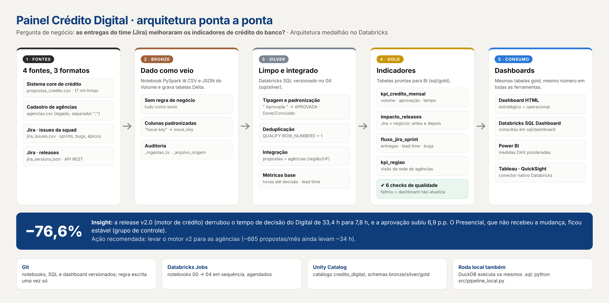
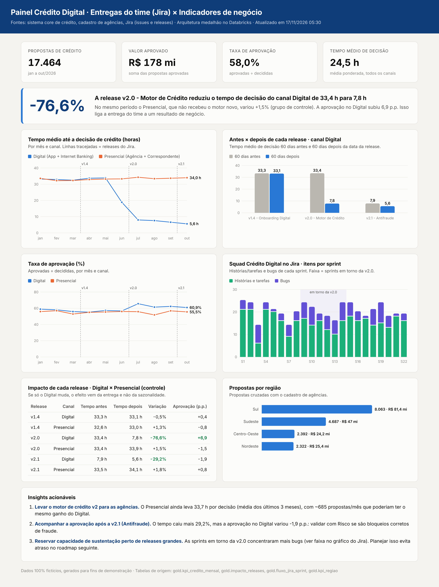
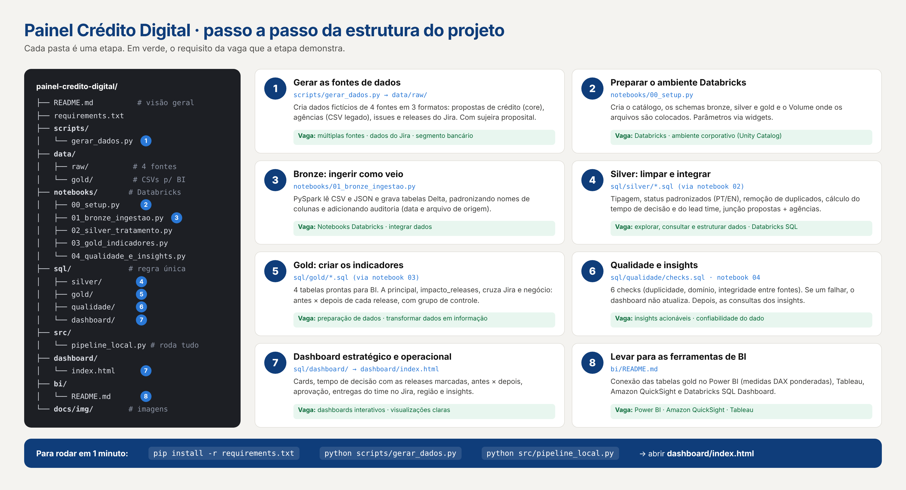

# 📊 Painel Crédito Digital · Entregas do time (Jira) × Indicadores de negócio

Case de **Análise de Dados no segmento bancário** usando **Databricks (Notebooks + Databricks SQL)**,
arquitetura medalhão (bronze → silver → gold), integração de **múltiplas fontes** (incluindo **Jira**)
e dashboards para **Power BI, Tableau, Amazon QuickSight** e HTML.

> **Pergunta de negócio:** as entregas da squad de Crédito Digital (registradas no Jira)
> melhoraram os indicadores de crédito do banco?



---

## 🎯 Resultado em uma frase

A release **v2.0 – Motor de Crédito** reduziu o tempo de decisão do canal **Digital** de
**33,4 h para 7,8 h (−76,6%)** e aumentou a aprovação em **+6,9 p.p.**, enquanto o canal
**Presencial** (que não recebeu a mudança e serve de **grupo de controle**) ficou estável.



### Insights acionáveis
1. **Levar o motor de crédito v2 para as agências:** o Presencial ainda leva ~34 h por decisão,
   com ~685 propostas/mês que poderiam ter o mesmo ganho.
2. **Acompanhar a aprovação após a v2.1 (Antifraude):** o tempo caiu mais 29%, mas a aprovação
   no Digital variou −1,9 p.p. Validar com a área de Risco se são bloqueios corretos de fraude.
3. **Reservar capacidade de sustentação perto de releases grandes:** as sprints em torno da v2.0
   tiveram ~29% de bugs, contra ~19% nas demais.

---

## 🧱 Fontes de dados (fictícias)

| Fonte | Arquivo | Formato | Sujeira tratada na silver |
|---|---|---|---|
| Sistema core de crédito | `propostas_credito.csv` | CSV `,` | status escrito de 8 formas diferentes, duplicados, valores nulos |
| Cadastro de agências | `agencias.csv` | CSV `;` (legado) | UF em minúsculo |
| Jira · issues da squad | `jira_issues.csv` | export do Jira | status PT/EN misturados, issues duplicadas |
| Jira · releases | `jira_versions.json` | JSON da API REST | tipagem de datas |

> Todos os dados são gerados por `scripts/gerar_dados.py` (semente fixa = resultado reproduzível).
> Nenhum dado real de banco ou de cliente é utilizado.

---

## 🗂️ Estrutura do projeto



```
painel-credito-digital/
├── scripts/gerar_dados.py          # 1. gera as 4 fontes em data/raw/
├── notebooks/                      # Notebooks Databricks (formato .py, importáveis via Git Folder)
│   ├── 00_setup.py                 # 2. catálogo, schemas e volume
│   ├── 01_bronze_ingestao.py       # 3. PySpark: CSV/JSON -> Delta (bronze)
│   ├── 02_silver_tratamento.py     # 4. executa sql/silver
│   ├── 03_gold_indicadores.py      # 5. executa sql/gold
│   └── 04_qualidade_e_insights.py  # 6. checks de qualidade + consultas dos insights
├── sql/                            # REGRA DE NEGÓCIO ÚNICA (Databricks SQL)
│   ├── silver/                     # limpeza, padronização, integração
│   ├── gold/                       # indicadores
│   ├── qualidade/checks.sql        # 6 checks, todos devem retornar 0
│   └── dashboard/                  # consultas do dashboard (Databricks SQL Dashboard e HTML)
├── src/pipeline_local.py           # roda TUDO localmente com DuckDB (mesmos .sql)
├── dashboard/                      # 7. dashboard HTML (template + index.html gerado)
├── bi/README.md                    # 8. Power BI (DAX), Tableau e QuickSight
├── data/raw/  data/gold/           # dados brutos e tabelas gold exportadas
└── docs/img/                       # imagens deste README
```

### Decisões técnicas (e por quê)
- **SQL como fonte única da regra.** O mesmo arquivo `.sql` roda no Databricks (Spark SQL) e localmente (DuckDB).
  Facilita code review, manutenção e entendimento por qualquer analista.
- **Bronze guarda o dado como veio** (tudo texto + colunas de auditoria). Se uma regra mudar, é possível reprocessar.
- **Grupo de controle** (Digital × Presencial) para separar o efeito da entrega de sazonalidade.
- **Médias ponderadas:** a gold guarda somas e contagens (`soma_horas_decisao`, `qtd_decididas`) para que o BI
  nunca calcule "média de médias".
- **Qualidade como portão:** se um check falhar, o dashboard não é atualizado com dado errado.

---

## ▶️ Como executar

### Opção A · Local (1 minuto, sem Databricks)
```bash
pip install -r requirements.txt
python scripts/gerar_dados.py
python src/pipeline_local.py
# abrir dashboard/index.html no navegador
```
Saída esperada do pipeline:
```
1) BRONZE  - ingestão das 4 fontes
2) SILVER  - limpeza, padronização e integração
3) GOLD    - indicadores de negócio
4) QUALIDADE - checks de dados        -> [OK] em todos
5) EXPORT  - CSVs + dashboard
```

### Opção B · Databricks
1. **Workspace → Git Folders → Create** e cole a URL deste repositório.
2. Rode `notebooks/00_setup.py` (cria catálogo `credito_digital`, schemas e volume).
3. Faça upload dos arquivos de `data/raw/` para `/Volumes/credito_digital/raw/arquivos/`.
4. Rode os notebooks `01` → `04` (ou crie um **Job** com 4 tarefas em sequência e agende).
5. Conecte o BI às tabelas `gold.*` (ver [`bi/README.md`](bi/README.md)).

---

## 🧰 Tecnologias
Databricks (Notebooks, Databricks SQL, Delta Lake, Unity Catalog, Jobs) · PySpark · SQL ·
Python · DuckDB · Power BI (DAX) · Tableau · Amazon QuickSight · HTML/JS (SVG) · Jira · Git

---

**Autor:** Anderson Joel Portes · [LinkedIn](https://linkedin.com/in/anderson-joel-portes) · [GitHub](https://github.com/AndersonJP)
